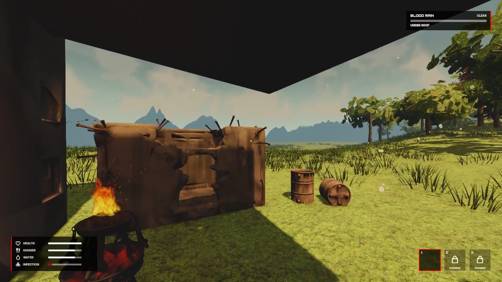
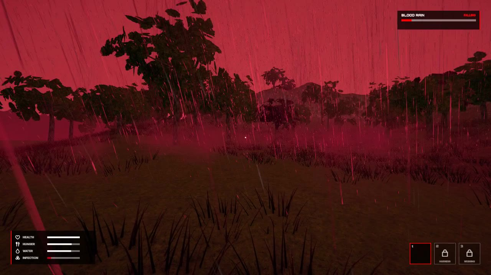

# Bloodrain: Alpha

Bloodrain is a 3D first-person survival game by ANERON GAMES, made in Unity 6 (URP, UI Toolkit, Input System).
This repository goes with the Part 3-A (alpha) submission for COMP305 Game Programming I. It holds a few short
excerpts of the code behind what the gameplay video shows. The full Unity project is private.

## The build

You wake in a ruined shelter on the outskirts of Sector 20, a sealed industrial sector where the rain falls as blood.
Hunger and thirst wear you down. In the open the blood rain fills a gauge; under a roof it drains, and a full gauge
raises infection. You search crates, inspect and carry what you find, read the sky and the map, and look for the way
out of the region at THE PASS. Walking through its gate is designed to end the run with YOU GOT OUT; in this build the
gate is still in test. A death brings you back to the shelter with RESPAWN. There is no score in this build.

## How the pieces fit

| Excerpt | What it shows | Where it is in the video |
| --- | --- | --- |
| [`excerpts/needs/SurvivalBody.Excerpt.cs`](excerpts/needs/SurvivalBody.Excerpt.cs) | The needs, the roof test (a ray up from the body) and the blood rain gauge | The HUD vitals; the gauge filling in the open and draining under the roof |
| [`excerpts/weather/RainField.Excerpt.cs`](excerpts/weather/RainField.Excerpt.cs) | The seeded weather field: the wind, a rain cell's life, the rain at a point | The storm gathering, then the blood rain |
| [`excerpts/map/MapSurvey.Excerpt.cs`](excerpts/map/MapSurvey.Excerpt.cs) | The map read from the scene: every roof on a 512 x 512 grid by batched raycast jobs | The MAP tab |
| [`excerpts/items/ItemLiquid.Excerpt.cs`](excerpts/items/ItemLiquid.Excerpt.cs) | A liquid's surface as a damped pendulum: level at any tilt, sloshing when moved | INSPECT of the bowl of soup |
| [`excerpts/interaction/SurvivalInteract.Excerpt.cs`](excerpts/interaction/SurvivalInteract.Excerpt.cs) | The eyes' ray: tap E to inspect, hold E to take or to search a crate | INSPECT of the soup and the water bottle |
| [`excerpts/body/HumanoidMotor.Excerpt.cs`](excerpts/body/HumanoidMotor.Excerpt.cs) | The crouch toggle and the headroom test that keeps the body down under a low roof | Crouch |

One frame of a run, in order:

1. `PlayerBrain` turns the keyboard and mouse into one input frame for the body (`Humanoid` and its motor).
2. `SurvivalBody` asks whether a roof is overhead and reads the rain where it stands from `RainField`, then updates the needs and the gauge.
3. `SurvivalInteract` casts the eyes' ray: an item can be inspected or taken, a crate can be searched.
4. The HUD and its screens (PACK, INSPECT, the take sheet, MAP, PAUSED, YOU DIED) draw it all with UI Toolkit.

`MapSurvey` reads the scene once at the start, asking the same roof question as `SurvivalBody`, so the map shows the
same shelter the needs use.

## Controls

| Input | Result |
| --- | --- |
| W A S D, mouse | Walk, look |
| Shift (hold) | Sprint; spends WIND |
| C | Crouch or stand (toggle) |
| Space | Jump from a stand |
| E (tap / hold) | INSPECT / take; hold on a crate to search it |
| Tab, M | PACK, MAP |
| F3 | First or third person |
| Esc | Close a screen; with nothing open, pause |

## Course and team

COMP305 Game Programming I, Part 3-A (alpha). ANERON GAMES.

## Note

The excerpts are shortened copies of project code and do not compile on their own. The Unity project, its assets
and its builds are private. The two screenshots are frames from the gameplay video.

Copyright 2026 Aneron Games. All rights reserved.
